# How coding agents were used

As of 5 November 2026, about 21:15 UTC.

Claude Code cloud agents wrote all of the code for openscan, the OX Security take-home. The human set direction, chose between options, read screenshots and decided every merge. Over 11 hours on 5 November 2026, one long build session laid the base. In the last 90 minutes, 13 shorter sessions ran in parallel and merged 10 PRs.

## Scope and sources

This covers the 14 Claude Code cloud sessions that worked on [vahagn-relcu/ox-scanner](https://github.com/vahagn-relcu/ox-scanner) on 5 November 2026, from 09:26 to about 21:15 UTC. Sessions on other repositories are left out.

- **Session transcripts**: the human's messages and the agent's replies, read through the Claude Code Remote session API.
- **Git history**: the commits on `main`; each agent commit carries a `Claude-Session` link back to the session that wrote it.
- **The brief**: [TASK.md](./TASK.md), which asks for a short explanation of how coding agents were used.

## Timeline

The main build session worked alone until 19:43. After that, up to seven sessions were open at once. Bars are grouped by intent; the one still running at 21:14 is marked active.

```mermaid
gantt
    title Sessions on 5 Nov 2026 (UTC), grouped by intent
    dateFormat HH:mm
    axisFormat %H:%M
    section Building
    Main build (since 09.26)        :19:40, 20:16
    Product owns scans              :20:16, 20:39
    Questions for you               :20:19, 20:40
    Public repo submission          :20:22, 21:11
    section Understanding
    Architecture diagrams           :19:44, 20:09
    Take-home improvements          :19:45, 20:24
    Codex memories                  :19:54, 20:47
    runStep walkthrough             :20:29, 20:40
    section Polishing
    App URL and UI polish           :19:44, 20:18
    Card density                    :19:55, 20:09
    Scope cut, README and merges    :active, 20:28, 21:14
    section Fixing
    Cascade delete fix              :20:27, 20:36
    Malformed session cookie        :20:57, 21:09
    Findings lost on rescan         :20:57, 21:11
```

Times are session start and last activity from the Claude Code Remote session API.

## What each session did

One long session built the product. Thirteen shorter, parallel sessions in the last 90 minutes then each took one feature, fix or question. Rows are in start order.

| Session | Intent | What the human asked | What the agent delivered | Result |
| --- | --- | --- | --- | --- |
| GitHub app with AI code analysis | Building | Build the POC from the brief, then iterate on product and design | Spec docs, TanStack Start + Cloudflare app, vendored security skills, Codex Cloud scans, products with shared memory, three landing-design rounds, CI with Bitwarden, favicon and logo | 17 commits, the base of the app |
| App URL and UI polish | Polishing | Document the production app URL, then UI fixes from four screenshots | App URL in the README; button, filter chip, tooltip and repo-list polish | [#5](https://github.com/vahagn-relcu/ox-scanner/pull/5) merged |
| Backend architecture diagrams | Understanding | "describe to me the backend architecture with big mermaid diagrams" | Architecture explained in chat; ER and state-machine diagrams in the README; mock AI mode removed | [#2](https://github.com/vahagn-relcu/ox-scanner/pull/2), [#4](https://github.com/vahagn-relcu/ox-scanner/pull/4) merged |
| Ox Security take-home task | Understanding | "find me best ways I can implement small things in this app" | Ranked list of 7, then 6 built: submit by repo URL, one active scan per repo, cancel, cheap polling, SARIF export, reviewer quick path | [#7](https://github.com/vahagn-relcu/ox-scanner/pull/7) merged into the default branch, then ported to `main` |
| Codex spawn cloud session memories | Understanding | "how does spawn cloud session of codex get all the memories?" | Scan-scoped tokens and read-only memory endpoints for Codex tasks, plus a "Test internet" check | [#8](https://github.com/vahagn-relcu/ox-scanner/pull/8) merged into the default branch; reopened as [#10](https://github.com/vahagn-relcu/ox-scanner/pull/10) and merged to `main` |
| Card density and spacing | Polishing | Denser cards, more room between them, "all over the website" | Spacing pass on six pages, separators removed, preferences as a stepper | [#3](https://github.com/vahagn-relcu/ox-scanner/pull/3), [#6](https://github.com/vahagn-relcu/ox-scanner/pull/6) merged |
| Product owns scans data model | Building | "update data model so that the Product owns scans" | `product_scans` table, per-repo scan on push, UI and README updates | [#9](https://github.com/vahagn-relcu/ox-scanner/pull/9) merged |
| Questions for you section refinement | Building | Ask only the "most impactful" questions; don't repeat skipped ones. Later: remove the `/design` page, "this should behave as an application not design mockup" | Shared high-impact rule in every prompt that raises questions, plus a backstop that drops near-duplicates of skipped questions; `/design` and the sample pages removed | Pushed to `main` and deployed |
| Public repo scan submission | Building | Accept `owner/repo`, one-command setup, OpenAPI, engine tests; then cap scan retries, and "write a test with mocked codex" | Repo-name parser, setup script, OpenAPI contract; tests from 70 to 135 (a subagent wrote them and found 3 bugs); retry limits; 13 fake-Codex state-machine tests | Pushed to `main` and deployed |
| Scan history cascade deletion bug | Fixing | Fix two correctness bugs: cascade delete, and a scan step that could run twice | Repos detached instead of deleted; a lease so a scan step can't run twice at once | Pushed to `main` and deployed |
| Scope cut, README and merges | Polishing | Remove a complex feature: "we don't need that complex part"; a 1–2 page README; "merge all branches into main" | Feature and its tables removed; short README with an honest agent account, old one moved to [docs/TECHNICAL.md](./docs/TECHNICAL.md); #9, #10 and #11 merged; #7 ported to `main` | Pushed to `main` and deployed |
| runStep walkthrough | Understanding | "walk through runStep failure modes", then "I don't know the code, what are compromises took here, what should I know" | Plain-language explainer of the retry layers and their gaps | Explanation only; the gaps were fixed in the public-repo session |
| Malformed session cookie | Fixing | Return 401, not 500, for a cookie that can't be decoded | Undecodable cookies treated as absent, in the session and in the GitHub sign-in callback; tests added | Pushed to `main` on "push to main" |
| Findings lost on rescan | Fixing | Keep open findings for unchanged files when a product is rescanned | Open findings carried into the new scan; dismissed and fixed ones stay out | [#11](https://github.com/vahagn-relcu/ox-scanner/pull/11) merged |

## How the work was run

The human ran up to seven agents at once, one task per session, and kept the merge decision for themself. Thirteen sessions started between 19:43 and 20:57 UTC, and ten PRs merged by 21:06.

- **Ask before building.** Three sessions started with a question, not a task: the backend architecture, how Codex tasks get memories, and "best ways I can implement small things". The human read the answer and then picked what to build, for example "do 1, 2, 3, 4, 6 (also in UI), 7". Why it mattered: the human kept the build on what the brief asks for, and the Codex question exposed a blocker (no internet in cloud tasks) before any code was written.
- **Learning the code from the agent.** In one session the human asked how the scan step fails, then "I don't know the code, what are compromises took here, what should I know". Why it mattered: the plain answer exposed two real gaps (a crash before the error handler, and unlimited retries). The human then had both fixed, with a test against a fake Codex.
- **Screenshots both ways.** For UI work the human sent screenshots with short notes ("app has rectangle buttons, use those"). The agents checked their own changes in a Playwright browser and sent screenshots back before merge. Why it mattered: the agents' screenshots passed their own checks. The human's caught what they missed: mismatched buttons, unclear filter chips, missing tooltips.
- **Design review on a shared page.** The main session built the landing designs from the app's real components and published them as one artifact. It republished that artifact five times. The human commented on specific parts, and the agent answered in the comment threads. Why it mattered: the agent could produce designs but not choose one. The human set the audience, rejected the styles that missed it, and picked Essay.
- **Research from source, not memory.** Before building, the agent cloned and read `login-with-chatgpt`, the `openai/codex` source (for the undocumented cloud-tasks API), seven security-skill repos and `bitwarden/sm-action`. Why it mattered: the human chose the sources. The skills list, login-with-chatgpt and Bitwarden's official action all came from the human, so the agent built on vetted work instead of guessing.
- **The human merges.** Every PR merged only after green checks and an explicit "merge" or "merge it". Agents asked before merging because a merge to `main` deploys to production. Why it mattered: with up to seven agents editing the same files, the merge was the one point where their work met. The human decided its order and timing.
- **PR watching.** Each session subscribed to its PR's activity and set a 50-minute safety-net check-in, then removed both after the merge.
- **Few subagents.** Only two sessions delegated work: the SARIF converter and its tests, and a test harness built in a separate worktree. The agents kept work that touched shared files for themselves.

## Where the human steered

The agents proposed and built. The human rejected designs, overruled one architecture recommendation, and cut or narrowed scope. The main build session alone had about 44 typed messages, 9 of them with screenshots, plus 4 comments on the design artifact.

| What the agent proposed or did | What the human decided |
| --- | --- |
| Nothing yet | Wrote the product brief: a GitHub App, GitHub login, onboarding, login with ChatGPT, a minimal dashboard, and three designs to pick from |
| A first scanner with its own prompts | Supplied the list of vetted security skills to scan with |
| Rounds of landing designs, from Signal, Ledger and Aurora to Console, Essay and Guilloche, on a shared artifact | Set the audience ("visitors will be team leads or CTOs"), rejected the styles that missed it, and shaped the rest in artifact comments: cream squiggle underlines, serif headings with sans small text, a dithered Apollo image |
| Recommended running scans in Cloudflare Containers | Picked Codex Cloud tasks on the user's ChatGPT session instead |
| One scan per repository | Scan several repositories as one product with shared memory |
| Two finalists | Chose Essay for the whole app; server-render only the landing page |
| Started installing the Bitwarden CLI in CI | Pointed it to Bitwarden's documented GitHub Action |
| Needed accounts and secrets it could not create | Set up the GitHub App, the Cloudflare API token and the Bitwarden secrets, then checked the deploy |
| Deploys ran from the default (working) branch | "only main should deploy to prod"; GitHub-first onboarding; `/home` instead of `/onboarding` |
| The app had a mock AI mode | Removed it |
| Seven ranked improvement ideas | Built six of them: "do 1, 2, 3, 4, 6 (also in UI), 7" |
| Six items to build in one session | "you can spawn multiple child sessions if there is anything to parallelize" |
| An HTTP memory endpoint for Codex tasks | "yes build it, keep inline summary as fallback" |
| Scans ran per repository | The product owns its scans; a push to a repo triggers a scan only if that repo is selected |
| Asked owners many questions, small architecture ones included | Ask only the most impactful questions, and never re-ask ones the owner skipped |
| Scans needed a linked repo id, and setup needed Cloudflare | Accept owner/repo for public repos, one-command npm setup, OpenAPI docs and engine tests; say plainly it is not a finished product, and why ChatGPT login was chosen |
| A complex feature built earlier in the day, not needed for the brief | Cut it entirely: "we don't need that complex part" |
| An 800-line README | Asked for 1–2 pages: how the brief was read, trade-offs, what's mocked, what was cut and why, and an honest account of the agent |
| A /design page of mockups inside the live app | Removed it: "this should behave as an application not design mockup" |
| Explained how runStep fails | Asked for it in plain words ("I don't know the code"), then had the gaps fixed: retries capped, with an exception for a Codex job still in progress |
| Recommended a branch and a draft PR for the public-repo work | Chose to push straight to main |
| Two PRs had merged into the default branch, not main | "merge all branches into main"; for the conflicting repo intake, kept main's version over the PR's |
| Engine tests ran without Codex | "can we write a test with mocked codex to check engine's state machine works as expected?" |
| The scanner asked the owner a question the code could answer | The AI must answer code-behaviour questions from the code and never ask the owner |

## Outcomes

### Caught along the way

- **Ranking bug.** A unit test showed test files outranked application code when picking files to review.
- **Stepper bug.** The new preferences stepper moved to the next step on Save instead of saving.
- **Two correctness bugs.** Removing a repo from the GitHub App cascaded into deleting its scans and findings. A stalled scan step could also be re-queued and run twice at once.
- **Codex limits found by research.** The agent read OpenAI's Codex docs: cloud tasks have internet off by default. So it built a scan-scoped HTTP token and kept the inline prompt as the fallback.
- **Reuse over new code.** The questions session first wrote its own similarity check, then switched to the existing `titleSimilarity` helper.
