# openscan

**AI security review for your GitHub repositories.** openscan reads a repo the way an attacker would and writes a short brief: what matters, what is risky, and what to do next.

Live at [openscan.underscore.am](https://openscan.underscore.am). Brief: [TASK.md](./TASK.md). Product spec: [PRODUCT.md](./PRODUCT.md). How to deploy and change it: [docs/TECHNICAL.md](./docs/TECHNICAL.md). How it was built with coding agents: [PROCESS.md](./PROCESS.md). API: [`public/openapi.json`](./public/openapi.json). Screens: [`docs/screens/`](./docs/screens).

> **A proof of concept, not a ready product.** There are no evals yet: those need security researchers, and were skipped on purpose. [More below](#status-a-proof-of-concept-not-a-product).

## Run it locally

Node.js 22+. No Cloudflare account needed.

```bash
npm install
```

```bash
npm run setup
```

```bash
npm run dev
```

Open http://localhost:3000. `npm run setup` creates `.dev.vars`, generates the secrets, checks your GitHub App credentials with GitHub and migrates the local database. If credentials are missing it tells you which; [docs/github-app.md](./docs/github-app.md) shows how to create them in about 5 minutes. To try it without a GitHub App, run `npm run setup -- --demo` and open `http://localhost:3000/api/dev/login?repos=OWASP/NodeGoat`.

## Status: a proof of concept, not a product

openscan shows the whole flow on real repositories, but it has not been hardened, load-tested or measured.

**Evals were skipped intentionally.** Saying whether a review is good means measuring it: which real vulnerabilities it finds, how many findings are wrong, whether severities and proofs of concept hold up, and how that moves as prompts, skills and models change. That needs a ground-truth corpus (repos with known and seeded vulnerabilities, findings adjudicated by people who do this for a living, a scoring rubric they agree on). That is work for **security researchers**, not something to improvise in a POC. The unit tests cover the deterministic parts, not the quality of AI findings.

**Why "Login with ChatGPT".** Scans run on each user's own ChatGPT plan. It keeps the implementation simple (no model keys, billing or quotas for us to run) and lets anyone in public run scans without the operator paying for them.

## How we read the brief

The customer asked for three things, and each one shaped the product:

- **"Not a raw scanner report."** The output is a *brief*: overall risk in one sentence, what matters, numbered next actions, then findings in fix order. A second agent tries to disprove each serious finding. The report marks it verified, needs validation, or rejected.
- **"Understand what matters."** Risk depends on facts the code can't show, such as whether the service is public and what data it holds. The AI asks about these while it reads, answers its own questions when later files settle them, and shows the user only the rest. Answers are reused, so it never asks twice. Onboarding also records preferences: frequency, depth, focus, severity threshold and audience.
- **"A product experience, not just an API."** You sign in with GitHub, install a read-only GitHub App, link ChatGPT and watch the first read with live progress. Then you land on a one-page dashboard, and scans run on a schedule or on push. A REST API (`/api/scans`, spec in [`public/openapi.json`](./public/openapi.json)) exists as a secondary way in: starting a scan is idempotent, progress can be polled cheaply, a scan can be cancelled, and a brief exports as SARIF.

"Code or dependencies" became both: AI code review plus dependency data from OSV.dev. The reader is an engineering lead or CTO who wants a defensible plan, not 400 rows.

## Trade-offs

| We chose | Instead of | Why, and what it cost |
| --- | --- | --- |
| **GitHub App** install | Pasting a repo URL | Private repos need access anyway, and scans can run while the user is offline. Costs more setup. Any public `owner/repo` (or GitHub link) can still be typed in and scanned without the app. |
| **User's own ChatGPT plan** ([login-with-chatgpt](https://github.com/opencoredev/login-with-chatgpt)) | Our API key | Simplest to build, no inference bill or keys, and anyone in public can run scans on their own plan. Costs a dependency on a young SDK and a 120 requests/min limit. |
| **Codex Cloud tasks** when a Codex environment exists | File batches only | The agent sees the whole repo, not the top 30 to 50 files. Uses undocumented endpoints; falls back to direct review. |
| **Workers + D1 + Queues** (TypeScript, `nodejs_compat`) | A Node server with long jobs | One cheap deploy. Scans become small retryable steps, and a cron revives stalled ones. Not a plain Node process. |
| **Validator agent** per serious finding | Reporting everything | Fewer false alarms; slower scans, more tokens. |

## What's mocked or unverified

- **Demo login** (`/api/dev/login`, `DEV_DEMO_LOGIN=1`, forced off in production) signs in a fake user with public repos.
- **Without ChatGPT**, the **heuristic engine** runs: real deterministic rules, OSV.dev and known-CVE checks, no AI. That is the "mocked scan" the brief allowed. Nothing returns made-up AI output.
- **Verified end to end:** demo login through onboarding, both scan kinds with real OSV results, dashboard, report, REST API, cron, production build.
- **Verified manually** by the owner across different repositories and accounts: ChatGPT device-login approval and AI scans, GitHub App install and sign-in, and webhooks.
- **Not verified:** the Codex Cloud path, which still needs a real Codex environment.

## What we cut, and why

- **MCP server and its OAuth 2.1 server** (about 1,300 lines, five tables). An authorization server is security-critical code to maintain, and the UI and REST API already meet the brief. Migration `0007` drops the tables.
- **Scripted mock-AI mode.** A second code path that only tested itself; the heuristic engine covers scanning without AI.
- **Five of six design directions.** The owner chose *Essay*: the report reads like a document.
- **Later:** report delivery (email, Slack, issues), dependency reachability, organizations and roles, fix PRs. Useful, but not needed to show what matters and what to do next.

## How the coding agent helped, and where it went wrong

The project was built with **Claude Code** as a pair programmer. The product owner made the product calls: flow, audience, naming and design.

It took 14 Claude Code cloud sessions on 5 November 2026: one long build session, then up to seven parallel sessions, each on one feature, fix or question. [PROCESS.md](./PROCESS.md) has the session-by-session account and every decision the product owner made.

```mermaid
gantt
    title Sessions on 5 Nov 2026 (UTC), grouped by intent
    dateFormat HH:mm
    axisFormat %H:%M
    section Building
    Main build (since 09.26)        :19:40, 20:16
    Product owns scans              :20:16, 20:39
    Questions for you               :20:19, 20:40
    Public repo submission          :20:22, 21:11
    section Understanding
    Architecture diagrams           :19:44, 20:09
    Take-home improvements          :19:45, 20:24
    Codex memories                  :19:54, 20:47
    runStep walkthrough             :20:29, 20:40
    section Polishing
    App URL and UI polish           :19:44, 20:18
    Card density                    :19:55, 20:09
    Scope cut, README and merges    :active, 20:28, 21:14
    section Fixing
    Cascade delete fix              :20:27, 20:36
    Malformed session cookie        :20:57, 21:09
    Findings lost on rescan         :20:57, 21:11
```



**Where it helped**

- Turned the brief and the owner's notes into `TASK.md` and `PRODUCT.md`, with each requirement mapped to code.
- Read the login-with-chatgpt source before coding and found how to replay the signed session through `proxyFetch`, so background scans use the user's plan without exporting tokens.
- Ran three rounds of design options with Playwright screenshots, then rebuilt every page in the chosen style.
- Checked its work: tests, builds and a Playwright run caught a file-ranking bug, a duplicate React during SSR, a hydration mismatch and GitHub rate limits.
- Vendored security methodology from Trail of Bits, Cloudflare, Anthropic, NVIDIA and others with licenses ([SKILLS.md](./SKILLS.md)) instead of ad-hoc prompts.

**Where it went wrong**

- **Scope creep.** The brief expected about 3 hours. The agent kept adding well-built optional systems (Codex Cloud, product memory, six designs, a full RFC-compliant OAuth server for MCP) without flagging their upkeep. MCP and OAuth were the clearest case and are now removed.
- **Built, then thrown away:** the mock-AI mode, all design options, and the `/design` page with its sample brief.
- **Confident without checking.** The Codex client follows endpoints mirrored from `openai/codex` and has never run against a real account. In CI it pinned `bitwarden/sm-action@v3`, a tag that doesn't exist.
- **Its own bugs:** the file-ranking bug was its code; its tests caught it.
- **Too much documentation:** the README reached 800 lines. The detail now lives in [docs/TECHNICAL.md](./docs/TECHNICAL.md).

The lesson: the agent is fast and careful inside a well-defined task, but it needs a person to say "that's enough".
