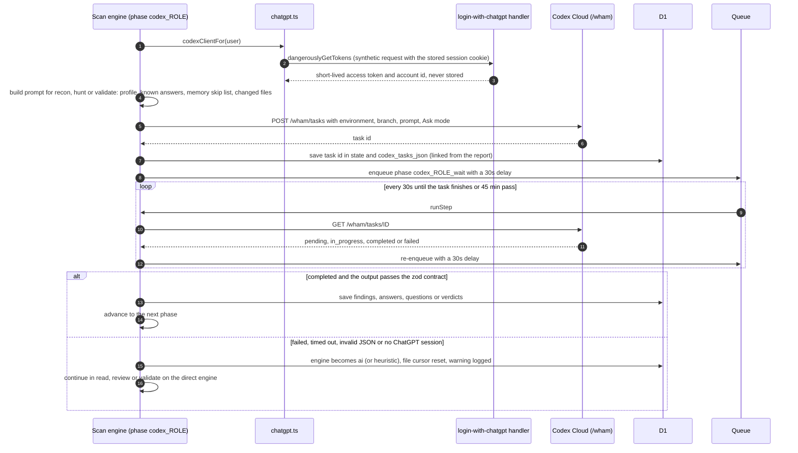
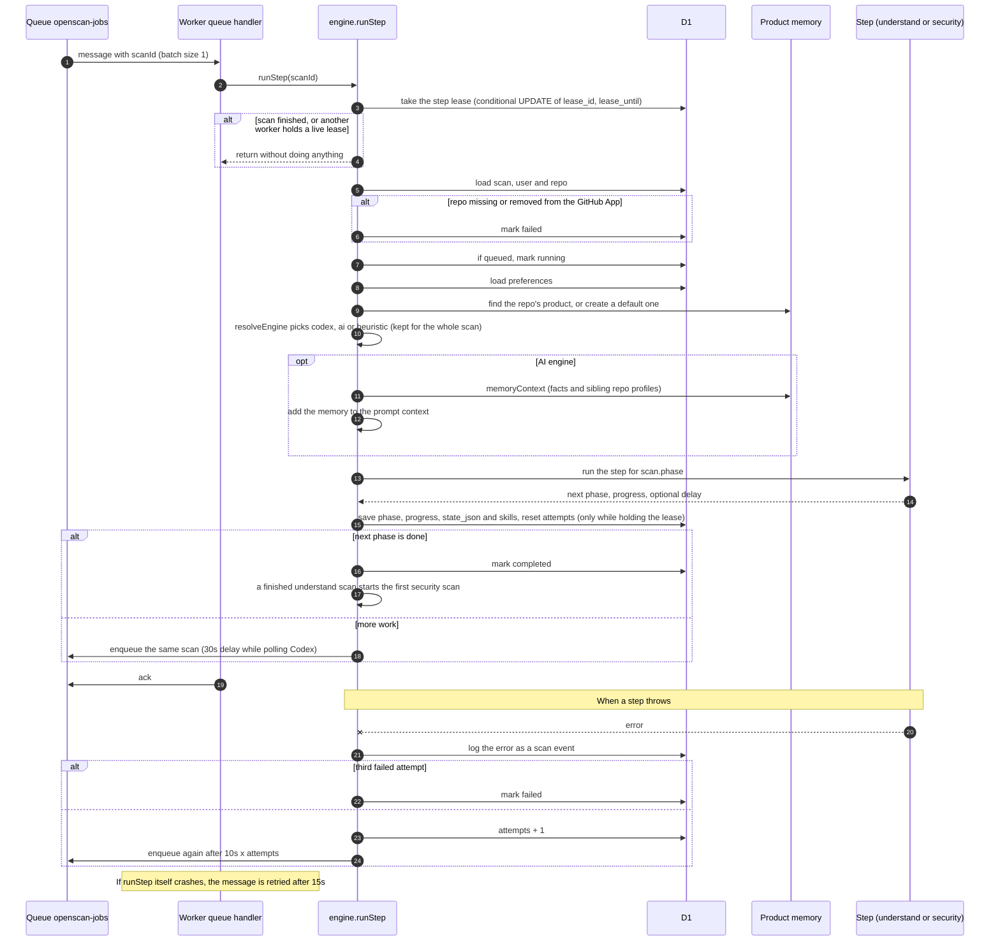
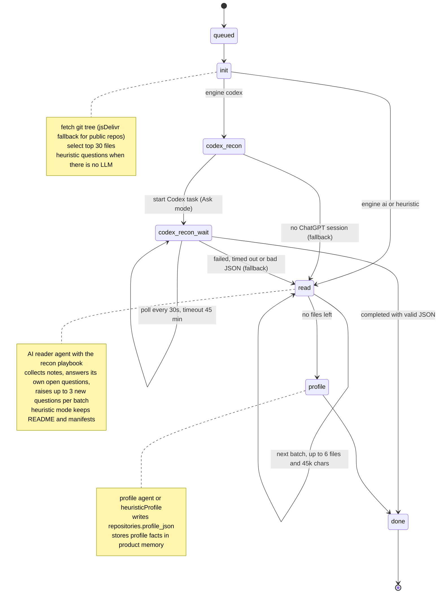
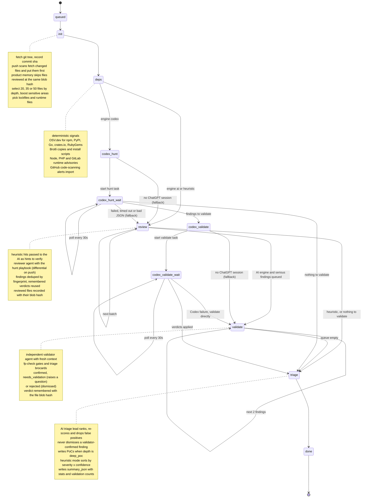
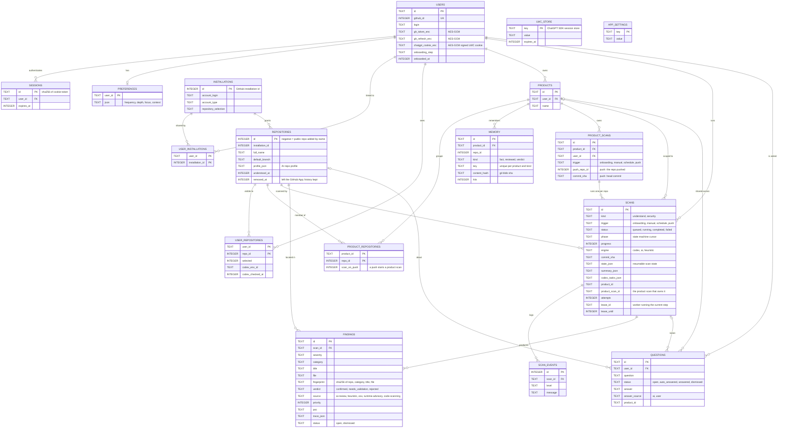
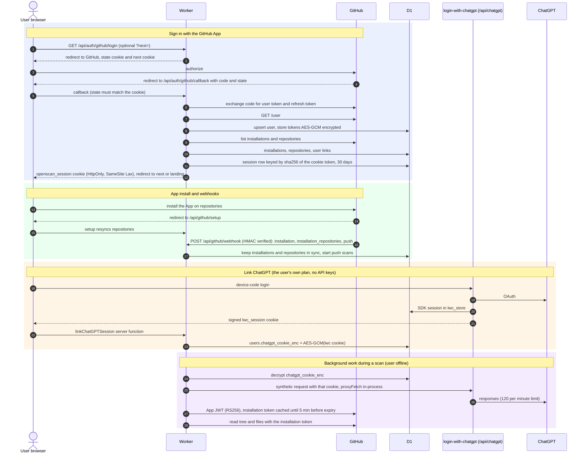

# openscan: technical guide

How to run, deploy and change openscan, and how it works inside. The short product write-up (brief, trade-offs, what's mocked, what was cut, how the coding agent was used) is the [README](../README.md).

## Which `.md` is for what

| File | What it is | Read it when… |
| --- | --- | --- |
| **[README.md](../README.md)** | Short write-up: product reading of the brief, trade-offs, what's mocked, what was cut, how the coding agent helped or went wrong | You want the overview |
| **[docs/TECHNICAL.md](./TECHNICAL.md)** (this file) | How to run locally, deploy, architecture, data model, technical decisions | You want to run or change the code |
| **[TASK.md](../TASK.md)** | The original assignment brief (transcribed from `Agentic_poc.pdf`) plus a table mapping each requirement to where it lives | You want to know what was asked |
| **[PRODUCT.md](../PRODUCT.md)** | Product spec: audience, required flows, the chosen design (Essay), preferences, questions model, out of scope | You want to know what we're building and why |
| **[SKILLS.md](../SKILLS.md)** | The agentic security skills the scanner uses (Trail of Bits, Cloudflare, Anthropic, NVIDIA, Cognition, OpenAI): which stage each runs in, how it's applied, licenses, and how to update them | You want to know *how* a scan reasons, or to change the methodology |
| [`skills/vendor/`](../skills/vendor) | Verbatim copies of those skills, with upstream licenses and pinned commits (`SOURCES.md`) | Auditing or updating the methodology |
| [`docs/screens/`](./screens) | Screenshots of landing → onboarding → brief → report → settings → product memory | Quick visual tour |
| [`docs/github-app.md`](./github-app.md) | Creating the GitHub App credentials, step by step | `npm run setup` asks for them |
| [`.dev.vars.example`](../.dev.vars.example) | Every secret and env var, with comments | Setting up your environment |
| [`public/openapi.json`](../public/openapi.json) | OpenAPI 3.1 spec of the REST API, generated by `npm run generate` (served at `/openapi.json`) | Calling the API |

---

## Run it locally

You need Node.js 22+ and npm. No Cloudflare account: D1, Queues and cron run locally inside `workerd`.

```bash
npm install
```

```bash
npm run setup
```

```bash
npm run dev
```

Then open http://localhost:3000.

`npm run setup` ([`scripts/setup.mjs`](../scripts/setup.mjs)) is safe to re-run (do it after pulling new migrations). It:

1. creates `.dev.vars` from [`.dev.vars.example`](../.dev.vars.example) if it is missing;
2. generates the secrets nobody needs to choose (`SESSION_SECRET`, `LWC_SECRET`, `GITHUB_WEBHOOK_SECRET`);
3. checks the GitHub App credentials (`GITHUB_APP_ID`, `GITHUB_CLIENT_ID`, `GITHUB_CLIENT_SECRET`, `GITHUB_APP_PRIVATE_KEY`): it signs a JWT with your key, asks GitHub which app it belongs to, checks the client ID and fills in `GITHUB_APP_SLUG`;
4. applies the D1 migrations to the local database.

If GitHub credentials are missing it says which ones and stops. **[github-app.md](./github-app.md)** walks through creating them (about 5 minutes; `localhost` callback URLs work, no tunnel needed). `--offline` skips the call to GitHub.

No GitHub App yet? Run `npm run setup -- --demo`. It enables demo sign-in (`DEV_DEMO_LOGIN=1`), and http://localhost:3000/api/dev/login?repos=OWASP/NodeGoat signs you in as a demo user with any public repositories (comma-separated).

After signing in, pick repositories (or type any public `owner/repo`), then **Login with ChatGPT** for a real AI review or **Skip** for the deterministic heuristic engine, answer the preference questions, and land on the brief.

> Anonymous GitHub API calls are limited to 60/hour per IP. Public repositories fall back to jsDelivr and `raw.githubusercontent.com`. If you still hit limits, set `GITHUB_PUBLIC_TOKEN` (any read-only token) in `.dev.vars`.

### Useful local commands

| Command | What it does |
| --- | --- |
| `npm run setup` | Create `.dev.vars`, generate secrets, check GitHub credentials, migrate the local D1 (`-- --demo`: no GitHub App) |
| `npm run dev` | Vite + workerd on :3000 (pages, API, queue consumer, D1) |
| `npm test` | Unit tests (Node's built-in test runner) |
| `npm run demo -- <github url>` | End-to-end REST walkthrough against the running dev server (demo sign-in, `POST /api/scans` twice to show it is idempotent, the progress poll with ETags, the brief, the SARIF export). Needs `DEV_DEMO_LOGIN=1` |
| `npm run typecheck` | `tsc --noEmit` |
| `npm run generate` | Regenerate `public/openapi.json` from the API contract (`-- --check` fails if it is stale) |
| `npm run build` | Production build into `dist/` |
| `npm run db:migrate:local` | Apply `migrations/*.sql` to the local D1 (also done by `npm run setup`) |
| `npx wrangler d1 execute openscan --local --command "select * from scans"` | Inspect local data |
| `curl "http://localhost:3000/cdn-cgi/handler/scheduled"` | Fire the cron (recurring reports + reviving stalled scans) |

To receive GitHub webhooks (reviews on push) locally, see [github-app.md → webhooks](./github-app.md#4-optional-webhooks).

---

## Deploy to Cloudflare

### With GitHub Actions (recommended)

[`.github/workflows/deploy.yml`](../.github/workflows/deploy.yml) runs on every push and pull request:

- **check** (no secrets): `npm ci`, typecheck, unit tests, production build.
- **deploy** (only from `main`: a push, or *Run workflow* on `main`): loads secrets from **Bitwarden Secrets Manager** with Bitwarden's [`bitwarden/sm-action`](https://github.com/bitwarden/sm-action), creates the D1 database and queue if they don't exist (`scripts/ci/provision.mjs`), applies D1 migrations, builds, and runs `wrangler deploy` with the Worker secrets (`--secrets-file`) and production vars (`--var`) in one step (`scripts/ci/worker-secrets.mjs`). `DEV_DEMO_LOGIN` is always forced to `0`. The job uses the `production` environment, so you can add required reviewers there.

Setup, once:

1. In Bitwarden Secrets Manager, create a project (e.g. *openscan*) with these secrets:

   | Secret | Value |
   | --- | --- |
   | `CLOUDFLARE_API_TOKEN` | API token with *Workers Scripts: Edit*, *D1: Edit*, *Queues: Edit* (Account) |
   | `CLOUDFLARE_ACCOUNT_ID` | Your Cloudflare account ID |
   | `APP_URL` | Public URL of the app. Production: `https://openscan.underscore.am` |
   | `SESSION_SECRET`, `LWC_SECRET` | `openssl rand -hex 32` each |
   | `GITHUB_APP_ID`, `GITHUB_APP_SLUG`, `GITHUB_CLIENT_ID`, `GITHUB_CLIENT_SECRET`, `GITHUB_WEBHOOK_SECRET` | From your GitHub App |
   | `GITHUB_APP_PRIVATE_KEY` | The `.pem` contents (multi-line is fine) |

2. Create a **machine account** with read access to that project and generate an **access token**. Add it to the repository as the Actions secret **`BWS_ACCESS_TOKEN`**. It is the only secret stored in GitHub.
3. The *Load secrets from Bitwarden* step maps each secret **ID** (not sensitive) to its env var name. If you recreate a secret in Bitwarden, update its ID there.
4. For the EU cloud (vault.bitwarden.eu), set the repository variable `BWS_CLOUD_REGION=eu`.

The first deploy creates the D1 database `openscan` and the queue `openscan-jobs`. To reuse an existing database, add a `D1_DATABASE_ID` secret to Bitwarden and to the mapping. Finally, point the GitHub App's URLs at `APP_URL` (the settings are in [github-app.md](./github-app.md), with `APP_URL` in place of `http://localhost:3000`).

Production URLs (`APP_URL` = `https://openscan.underscore.am`):

| What | URL |
| --- | --- |
| App / GitHub App homepage | `https://openscan.underscore.am` |
| GitHub App callback URL | `https://openscan.underscore.am/api/auth/github/callback` |
| GitHub App setup URL | `https://openscan.underscore.am/api/github/setup` |
| GitHub App webhook URL | `https://openscan.underscore.am/api/github/webhook` |

### By hand

```bash
npx wrangler login
```

```bash
npx wrangler d1 create openscan
```

Paste the printed `database_id` into `wrangler.jsonc`.

```bash
npx wrangler queues create openscan-jobs
```

```bash
npm run db:migrate:remote
```

Set each secret (you'll be prompted for the value):

```bash
for s in SESSION_SECRET LWC_SECRET GITHUB_APP_ID GITHUB_CLIENT_ID GITHUB_CLIENT_SECRET GITHUB_WEBHOOK_SECRET GITHUB_APP_PRIVATE_KEY; do npx wrangler secret put $s; done
```

Set `APP_URL` and `GITHUB_APP_SLUG` in `wrangler.jsonc` `vars`, then:

```bash
npm run deploy
```

Finally, point the GitHub App's URLs at the deployed `APP_URL`. Queues and cron triggers are available on the Workers Free plan.

---

## How it works

```
                      ┌──────────────────────── Cloudflare Worker (src/server.ts) ───────────────────────┐
 browser ── HTTPS ──▶ │ fetch: TanStack Start (SSR landing, client pages, server fns, /api/*)            │
                      │   /api/auth/github/*   GitHub App user OAuth  ──▶ D1 users/sessions              │
                      │   /api/github/webhook  installation / repos / push ──▶ D1, enqueue scans         │
                      │   /api/chatgpt/*       login-with-chatgpt handler (D1-backed session store)      │
                      │   /api/scans[/:id]     REST: start / list / poll scans                           │
                      │ queue:  one scan STEP per message ──▶ next step re-enqueued                      │
                      │ cron:   */15 → recurring reports per preference, revive stalled scans            │
                      └────────────┬───────────────────────────────┬──────────────────────┬──────────────┘
                                   │ installation token             │ proxyFetch (in-process)│
                              GitHub REST                    ChatGPT (user's plan)        OSV.dev
```

### Engines

| Engine | When | How the AI work runs |
| --- | --- | --- |
| `codex` | ChatGPT linked **and** the user has a [Codex Cloud environment](https://chatgpt.com/codex/settings/environments) for the repo | Three Codex Cloud tasks per scan, run in Ask mode (read-only): **recon** (profile + questions), **hunt** (review the whole repo), and a separate **validate** task, which is a fresh agent that tries to refute each finding. Tasks are polled every 30 s via delayed queue messages. Task links appear on the report. |
| `ai` | ChatGPT linked, no Codex environment (or a Codex task failed) | The Worker sends ranked file batches to ChatGPT through the login-with-chatgpt proxy. |
| `heuristic` | ChatGPT not linked, or `AI_MODE=heuristic` | Deterministic rules plus OSV and runtime advisories only. |

The Codex client (`src/lib/codex/cloud.ts`) uses the same ChatGPT backend endpoints as `codex cloud` (`/wham/environments/by-repo/…`, `/wham/tasks`). These are mirrored from `openai/codex` and are **not a documented public API**. Any Codex error (session expired, task failed or timed out, output not matching the JSON contract) logs a warning and falls back to the `ai` engine for that scan.

How one Codex task runs (`runCodexTask` in `src/lib/scanner/engine.ts`):



### Products and unified memory (`src/lib/products.ts`)

A **product** is a named group of repositories (for example `api` + `web` + `infra`). Each repo belongs to one product per user. Onboarding creates the first product. More can be created on `/products/new`. Questions and answers are shared across the product, so the AI never asks the same thing per repo.

**Products own scans.** A review is a **product scan** (table `product_scans`), and it owns one repository scan per member repo (`scans.product_scan_id`). The brief's *Run a fresh review of …* picker lists products, scheduled reports run once per product, and the onboarding report is the product's first review. Each member repo has a **scan on push** switch (`product_repositories.scan_on_push`, on the product page): a push to its default branch starts a product scan with a differential review of only that repo; its siblings reach the agents through product memory. Choosing *On every push* in preferences turns the switch on for every repo, and moving away from it turns them all off. `POST /api/scans {productId}` reviews a product; `{repo: "owner/name"}` (any public repository) or `{repoId}` reviews one repo inside its product.

Every product has one **memory** (table `memory`), so agents don't re-check the same things:

| Kind | What is remembered | How agents use it |
| --- | --- | --- |
| `fact` | Profile facts (auth, deployment, data stores), `UNENFORCED:` assumptions, owner answers | Injected into every agent prompt (direct and Codex) as *established facts*, together with the profiles of the product's other repos for cross-repo trust boundaries |
| `reviewed` | `repo:path` at a git blob hash, with its outcome | Security scans **skip files reviewed at the same hash** within 30 days (14 for deep scans). Push-changed files are always re-reviewed. Codex tasks get the skip list. |
| `verdict` | Validator outcome for a claim, plus the file's blob hash | The same claim (same file and category, similar title) on **byte-identical code** keeps its earlier verdict: rejected stays dismissed, confirmed carries over without re-validation. Any code change triggers fresh validation. |

`/products/:id` shows the memory, with a hit counter per entry ("re-checks avoided"). Every entry, or a whole kind, can be forgotten.

### Scan engine (`src/lib/scanner/engine.ts`)

A resumable state machine. **Each queue message runs exactly one step** and stores its state in D1, so every Worker invocation stays short, retries are per step, and the UI gets fine-grained progress for free.

**Lifecycle.** `queued → running → completed | failed | cancelled`. A partial unique index (`scans_one_active`, migration `0011`) allows only **one active scan per user, repository and kind**: two concurrent `POST /api/scans` requests can't queue two scans, and the loser gets the winner's id back with `existing: true`. Cancelling sets `cancelled` at once; the step in flight finishes, but its final write is fenced on status (and on the step lease), its follow-up message can't take the lease of a cancelled scan, and findings already written are kept. Cancelling also revokes the scan's Codex agent tokens.

| Kind | Steps | Purpose |
| --- | --- | --- |
| `understand` | `init → read* → profile` | Onboarding "AI reads your repo": builds a repo profile (stack, entry points, data stores, auth, sensitive areas) and raises or self-answers questions |
| `security` | `init → deps → review* → validate* → triage` | The report. `deps` runs the deterministic signals: OSV, install scripts, Node/PHP/GitLab/Brotli runtime advisories, GitHub code-scanning import. `review` does batched AI code review (diff-first on push). `validate` sends each serious finding to an **independent validator** that confirms it, marks it needs-validation (which raises a question for you), or rejects it. `triage` ranks findings, writes *what matters* / *next actions*, and adds PoCs when `depth = deep_poc` |

How one queue message is processed (`runStep`):



Each state below is `scans.phase`. A self-loop is one more queue message for the same phase (the next file batch, the next two findings to validate, or another Codex poll). If a step throws (including while it is being set up: loading the user, preferences or product), the same phase is retried after 10 s × attempt; after 3 attempts the scan is marked `failed`. The cron also re-enqueues any queued or running scan with no update in 10 minutes, unless a step still holds a live lease. Each such revival uses an attempt from the same budget, so a step that keeps killing its worker fails instead of looping. The exception is a scan polling a Codex task that, as of its last poll, is still `pending` or `in_progress` and within the 45-minute Codex timeout: it is re-enqueued without using an attempt (`reviveStalledScans`, `waitingOnLiveCodexTask` in `engine.ts`).

Each step runs under a lease (`scans.lease_id`, `lease_until`, see `src/lib/scanner/lease.ts`), so a duplicate queue message or a cron revival never runs the same step twice at once. The lease lasts 15 minutes, the longest a queue consumer may run. The step's writes are fenced on `lease_id`, and the lease is released before the next step is enqueued. A worker that dies leaves an expired lease, which the next delivery takes over.

When a repository is removed from the GitHub App (or the app is uninstalled), its `repositories` row is kept and marked `removed_at`, and users are unlinked from it. Deleting the row would cascade into the user's scans, findings and questions, so a database trigger refuses to delete a repository that has scans. Granting the repository again clears `removed_at`.

**`understand`**



**`security`**



**Agents** (`src/lib/ai/agents.ts`) are role prompts with zod output schemas: *reader*, *architect*, *reviewer*, *validator*, *triage lead*. Their methodology comes from published agentic security skills, distilled into playbooks (`src/lib/skills/playbooks.ts`). [SKILLS.md](../SKILLS.md) maps every skill to its stage. Calls go through the AI SDK (`streamText` + `Output.object`), with a tolerant JSON fallback. Static-analyzer hits are passed to the reviewer as hints to confirm or reject.

**Heuristic engine.** If the user skips ChatGPT, their session expires, or `AI_MODE=heuristic`, the same pipeline runs with deterministic rules (secrets, injection sinks, TLS off, CI risks) plus OSV. Scans never fail just because the AI is unavailable.

### Data model (`migrations/`)



`scans.product_id`, `scans.product_scan_id` and `questions.product_id` were added by `ALTER TABLE` without a foreign key; the link to `products` is kept in app code. `lwc_store` and `app_settings` stand alone.

`users` · `sessions` · `installations` · `user_installations` · `repositories` (+ `profile_json`) · `user_repositories` (`selected`, Codex environment) · `products` · `product_repositories` (`scan_on_push`) · `product_scans` (one review of a product: trigger, pushed repo and commit) · `memory` · `preferences` · `scans` (one repository job: status/phase/progress/state/summary/skills/Codex tasks/product/product scan) · `scan_events` (activity log) · `findings` (severity, priority, PoC, fingerprint, verdict, trace, threat model, source, skills) · `questions` (open / auto_answered / answered) · `lwc_store` (ChatGPT SDK sessions) · `app_settings` (unused since the design was chosen; kept for future settings).

### Identity, tokens and secrets



- **Repository contents are always read with installation tokens.** User tokens are only used to discover which repositories a user can see, so background scans never need the user online.
- **ChatGPT tokens never leave the SDK.** The Worker stores the encrypted signed SDK cookie and replays it in-process. Codex is the one exception: it gets a short-lived access token, and the refresh token stays redacted inside the SDK.

### REST API (cookie-authenticated)

The full spec is [`public/openapi.json`](../public/openapi.json) (OpenAPI 3.1, served at `APP_URL/openapi.json`). `npm run generate` builds it from [`src/lib/api/contract.ts`](../src/lib/api/contract.ts), which also holds the request schemas the handlers validate with, using zod 4's JSON Schema conversion. The generator fails when a file under `src/routes/api` is missing from the contract, and a unit test fails when the committed spec is stale.

| Method | Path | Description |
| --- | --- | --- |
| `POST` | `/api/scans` | `{ productId }` → `202 { productScanId, scanIds, url }`; or one repo: `{ repo: "owner/name" }` (any public repository, or a GitHub URL) or `{ repoId }`, plus `kind?: "security" \| "understand"` → `202 { id, repo, url, existing: false }` with a `Location` header, or `200 { …, existing: true }` when that scan is already running (safe to retry) |
| `GET` | `/api/scans` | Your product scans (each with its repository scans) and the flat list of scans |
| `GET` | `/api/scans/:id` | Status, phase, progress, event log, summary, findings, questions. ETag'd: `If-None-Match` → `304` |
| `GET` | `/api/scans/:id/progress?since=<eventId>` | The cheap poll: `{ status, phase, progress, live, updated_at, events, cursor }` with only the log lines after `since`. Pass `cursor` back as `since`. ETag'd |
| `POST` | `/api/scans/:id/cancel` | `200 { id, status: "cancelled" }`; `409 { error: "not_active", status }` if it already finished |
| `GET` | `/api/scans/:id/sarif` | The brief as **SARIF 2.1.0** (download), for GitHub code scanning or any SARIF tool. Dismissed, fixed and validator-rejected findings are included as suppressed results. `409` until the scan completes |
| `POST` | `/api/github/webhook` | GitHub App webhook (HMAC-verified) |
| `*` | `/api/chatgpt/*` | login-with-chatgpt routes (`login`, `status`, `session`, `models`, `responses`, …) |

---

## Technical decisions

- **TanStack Start on Workers.** One deployable gives pages, typed server functions for the UI, and plain API routes for REST and webhooks. The same Worker exports `queue` and `scheduled` handlers (`src/server.ts`), so there's no separate backend to run.
- **Selective SSR: only the landing page renders on the server.** `src/start.ts` sets `defaultSsr: false`; the root and `/` opt back in with `ssr: true`. The public page arrives as full HTML (fast first paint, crawlable), while signed-in pages render in the browser and load their data through server functions. That keeps the Worker's SSR work to one page, avoids hydration mismatches on live data (relative times, progress), and shows a quiet wordmark while a page loads.
- **One design system (Essay).** Tokens in `src/styles.css` (paper, ink, cream squiggle; Newsreader, Instrument Serif, Inter, JetBrains Mono) and primitives in `src/components/ui.tsx` (`Page`, `Masthead`, `Margin`, `SectionHead`, `Severity`, `Verdict`, `Progress`). Every page is a document: one 42rem reading column, notes in the right margin, severity as words rather than coloured pills.
- **D1 + Queues instead of a long-running job.** Workers are request-scoped, so a repo review is split into small idempotent steps. Steps are retried with backoff, and a cron revives anything stalled for more than 10 minutes.
- **The GitHub App reads code with installation tokens; user tokens are used only to discover repos.** Background scans never depend on a user being online. User tokens are AES-GCM encrypted at rest and refreshed automatically.
- **Public repositories by name.** Any public repo can be added or scanned as `owner/name` or a GitHub link, without installing the app (`linkPublicRepo` in `src/lib/github/repos.ts`). It is stored under a negative id with no installation and always read anonymously, even when someone else has the app installed on the same repo, so another user's installation token (and what it unlocks, like code scanning alerts) never serves it. That is why `repositories.full_name` is not unique (migration `0010`).
- **ChatGPT tokens stay server-side.** For background scans we store the user's *signed SDK session cookie* (encrypted) and replay it through `auth.proxyFetch()`, which calls the SDK handler in-process. The SDK's own session store is a D1 table, so sessions survive deploys. Codex Cloud task calls aren't behind the SDK proxy, so for those only, the Worker uses `dangerouslyGetTokens()` to get a fresh **short-lived access token + account id**. The refresh token stays redacted inside the SDK, and access tokens are never stored or logged.
- **Model discovery, not hardcoding.** The model comes from the account's `/models` list via a preference order (`PREFERRED_MODELS`).
- **Questions are first-class data.** They're deduplicated, capped per repo, answered by the AI with evidence or by the user, and fed into every later scan as known answers.
- **Bounded context.** Files are ranked for security relevance (`select-files.ts`, unit-tested), truncated per file, and batched by a character budget. Depth preference controls how many files are reviewed.
- **Real dependency data.** OSV.dev `querybatch` (free, no key) over lockfiles and manifests (npm, PyPI, Go, crates.io, RubyGems).
- **Methodology from vetted skills, not ad-hoc prompts.** Trail of Bits, Cloudflare, Anthropic, NVIDIA, Cognition and OpenAI skills are vendored with their licenses. Their methods run as agent playbooks; parts that can be made deterministic run as tested code (runtime advisories, agentic-actions rules). A separate validator agent tries to refute every serious finding before it reaches the report.
- **The database is the source of truth for the scan lifecycle.** "One active scan" is a partial unique index rather than a check-then-insert in app code, and final state changes are compare-and-set updates. Retries, double-clicks, queue redelivery and cancel racing a running step all end in a consistent state. Tests run this SQL on SQLite, not a mock.
- **Progress by polling, not SSE or WebSockets.** A scan is a chain of short queue steps, so no long-lived request knows when it is done, and Workers bill for open connections. Clients poll `…/progress` every 2 s, get only new log lines (cursor), and an empty `304` while nothing changed (ETag). The report page refetches the full brief only when `updated_at` moves. If push ever matters, a Durable Object per scan could fan out the same events.
- **SARIF out.** SARIF 2.1.0 (with `security-severity`, stable `partialFingerprints`, and suppressions for dismissed or rejected findings) plugs the brief into GitHub code scanning or an ASPM platform without a custom integration.
- **Graceful degradation everywhere:** heuristic engine without AI, jsDelivr/raw CDN fallback for public repositories, structured-output → plain-JSON fallback for models.

### Status: proof of concept, and no evals

openscan is a proof of concept, not a ready product; see the [README](../README.md#status-a-proof-of-concept-not-a-product). There is no eval harness: the unit tests cover the deterministic parts (file ranking, dependency parsing, heuristics, skill vendoring, the API contract), not the quality of AI findings. Measuring that needs a ground-truth corpus built and adjudicated by security researchers, which was skipped on purpose.

### Known limitations

- **Codex Cloud** uses undocumented ChatGPT backend endpoints, the same ones `codex cloud` uses, so they may change. Each user must create a Codex environment per repository at chatgpt.com/codex. The Codex path has not been verified against a real ChatGPT account.

- Only some of the end-to-end flow could be verified in the build sandbox. **Verified:** demo login, repo selection, preferences, the understand scan, the security scan with real OSV results, the dashboard, the report, the REST API, cron, the production build, and `wrangler deploy --dry-run`. The ChatGPT SDK worked up to OpenAI's device-code step. **Not verified (needs real accounts):** the ChatGPT device-login approval and AI-mode scans, GitHub App install/OAuth, and webhooks.
- Large monorepos: only the top-ranked files are reviewed (30 to 50 per scan by depth). Truncated trees are noted in scan state.
- Dependency findings are not reachability-checked yet. The AI triage and the user's context calibrate their severity.
